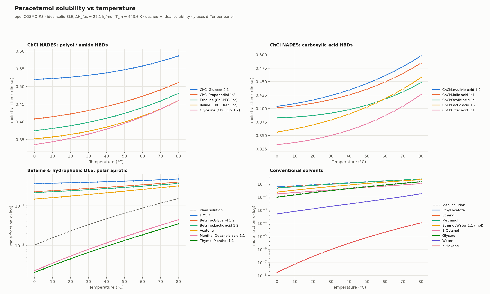

# EutecticSolvent · OS-NADES Simulator

Computing the solubility and mole fractions of components in complex (deep eutectic) solvents.

Predicts solid solubilities in conventional solvents and **(natural) deep eutectic solvents**
from first principles. It turns the FACCTs
[OPI openCOSMO-RS tutorial](https://www.faccts.de/docs/opi/nightly/docs/contents/notebooks/opencosmors.html)
into an application with a web UI, a CLI, a compound library and support for multi-component solvents.

```
SMILES / XYZ ──RDKit 3D──► GFN2-xTB opt (ORCA) ──► ORCA !COSMORS (BP86/def2-TZVPD gas + CPCM)
      └──► .orcacosmo σ-surface ──► openCOSMO-RS 24a ──► ln γ ──► SLE solubility, screening, Gᴱ
```

## Features

* **Compound library**: add molecules or ions from presets, SMILES, XYZ, or existing `.orcacosmo`
  files. The library supports several conformers per species and shows a 3D viewer, σ-profiles
  and σ-moment descriptors.
* **Fusion data lookup**: when you add a neutral compound, its measured ΔH_fus and T_m are fetched
  automatically from [Cheméo](https://www.chemeo.com), which collects NIST WebBook and literature DSC
  values. The compound is matched by InChIKey, so only the exact molecule is accepted. The source
  reference (DOI) is stored with the species. If only a melting point is published, ΔH_fus is estimated
  with Walden's rule (ΔS_fus ≈ 56.5 J/mol/K) and flagged as an estimate. In the library, "Look up
  published values" lists every value found so you can pick another reference. Values you enter
  yourself are never overwritten.
* **Your own solvents**: switch on "Use as a solvent" for any neutral library species, tick
  "Also use it as a solvent" when adding a new molecule, or press "Save as solvent" on a custom
  mixture. These solvents then show up on the Solubility, Temperature curves and NADES pages (group
  "My solvents / custom") and in the CLI. They are stored in `data/library/solvents.json`.
* **Solubility**: ideal-solid SLE, `ln(xγ) = -ΔH_fus/R(1/T-1/T_m) + ΔCp/R(T_m/T-1-ln(T_m/T))`.
  * The *iterative* mode solves the equation self-consistently with a bracketed root search.
  * The *infinite-dilution* mode is the tutorial's non-iterative variant.
  * You can screen many solvents, scan temperature, add water (wt%) to any solvent, and get
    results as mole fraction, mass fraction and g/kg.
* **Temperature curves**: solubility vs T for many solvents at once, grouped by solvent class
  (ChCl NADES with polyol/amide or acid HBDs, betaine/hydrophobic DES, conventional solvents).
  Each panel picks a linear or log scale on its own. The page includes a temperature-gain table
  for picking cooling-crystallisation solvents, plus CSV and PNG export.
* **NADES**: 26 preset systems.
  * ChCl-based (Reline, Ethaline, Glyceline, organic acids, glucose), betaine-based, and
    hydrophobic (menthol/thymol/decanoic acid) systems.
  * A custom HBA:HBD:… builder with an electroneutrality check.
  * Pick a solute to compare its ideal mole fraction (γ = 1, from ΔH_fus/T_m/ΔCp only) with the
    openCOSMO-RS solubility in the designed mixture (x/x_ideal, ln γ, g/kg, and a T scan).
  * **Eutectic phase diagram** of an HBA + HBD pair: the liquidus of each component, the eutectic
    point, how far it lies below the ideal eutectic (how "deep" it is), and the composition window
    that is liquid at your operating temperature. Salts such as choline chloride are handled as ions,
    referenced to their pure molten salt. Approximate literature fusion data ship for water, ChCl, urea,
    glycerol, ethylene glycol, menthol, thymol, decanoic acid, glucose and DMSO.
  * Per-species activity coefficients (residual and combinatorial), the mixture σ-profile,
    and binary Gᴱ/RT curves.
* **ORCA backends**:
  * `native`: ORCA runs directly on the host.
  * `docker`: a Linux x86-64 ORCA build runs on macOS/arm64 through an amd64 container.
    ORCA is bind-mounted into the container, never copied into the image.

## Install

```bash
uv venv -p 3.12 .venv
uv pip install -p .venv/bin/python -e ".[dev]"
```

ORCA ≥ 6.0 must be installed separately (free for academic use from the ORCA forum).

```bash
.venv/bin/osnades setup --orca-home ~/orca_6_1_0 --ncores 4   # builds the Docker runtime if needed, runs a test job
```

On this machine, `~/orca_6_1_0` holds the **Linux x86-64** build. The `auto` mode detects
this and uses Docker; Docker Desktop must be running. Another option is to install the native
macOS-arm64 ORCA build and set `--mode native`, which is several times faster.

> ORCA 6.1.0 has no `--version` flag, and OPI 2.0 asks for ORCA ≥ 6.1.1. The app therefore turns
> off OPI's version check (`version_check = false` in `data/osnades.toml`). Upgrading to 6.1.1
> is recommended.

## Use

### Web app

```bash
.venv/bin/osnades app          # http://localhost:8501
```

The app has these pages: Overview (one-click "compute all preset species"), Compound library,
Solubility, Temperature curves, NADES designer, Jobs (live ORCA queue), and Settings.

### CLI

```bash
osnades add paracetamol                                   # preset SMILES + fusion data
osnades add vanillin --smiles "COc1cc(C=O)ccc1O" --dh-fus 22400 --t-fus 355
osnades bootstrap "Reline (ChCl:Urea 1:2)" Water Ethanol  # compute species for these systems
osnades import myspecies conf0.orcacosmo conf1.orcacosmo  # reuse σ-surfaces
osnades list
osnades fusion paraCoumaric_acid                          # list published ΔH_fus / T_m; --apply stores the suggestion
osnades fusion --all --apply                              # fill in every neutral species that has no data
osnades solubility paracetamol -s Water -s Ethanol -s "Reline (ChCl:Urea 1:2)" -T 298.15 318.15
osnades solubility paracetamol -s "choline:chloride:glycerol=1:1:2" --water 10 --csv out.csv
osnades curves paracetamol --tmin 0 --tmax 80 -o results/paracetamol_solubility_vs_T   # CSV + grouped PNG
osnades binary water ethanol -T 298.15
osnades solvent add vanillin                              # use a library species as a solvent
osnades solvent add "Thymol:Decanoic acid 1:2" "thymol:decanoic acid=1:2"
osnades solvent list
osnades eutectic thymol menthol -T 298.15 -o thymol_menthol   # eutectic point, liquid window, CSV + PNG
osnades eutectic "choline chloride" urea --dh-b 14600 --tm-b 406
```



### Reproduce the tutorial

```bash
OPI_ORCA=$PWD/osnades/orca_shim OSNADES_ORCA_HOME=~/orca_6_1_0 .venv/bin/python tutorial/run_tutorial.py
.venv/bin/python -m pytest -q
```

| Paracetamol, 298.15 K | tutorial non-iter. | this app non-iter. | tutorial iter. | this app iter. | experiment |
|---|---|---|---|---|---|
| Water   | 7.424e-4 | 7.424e-4 | 1.949e-4 | **7.670e-4** | 1.773e-3 |
| Ethanol | 1.712e-1 | 1.712e-1 | 9.117e-2 | **9.983e-2** | 7.586e-2 |

The σ-descriptors and non-iterative results match the tutorial exactly. The tutorial's iterative
values come from `fsolve` applied to `|f(x)|`, so they are not converged roots.
`tests/test_thermo.py` checks that this app's iterative answer satisfies the SLE equation to 1e-6.

## Model notes and limits

* Salts are split into their ions, as is usual in COSMO-RS (choline⁺ + Cl⁻). The mole fraction `x`
  counts every species. Internally, ln γ is computed against the COSMO reference and converted to
  the pure-liquid reference of the solute. This way no unphysical "pure ion" liquid is ever needed.
* The model assumes an ideal solid phase. It ignores polymorphs, solvates, solute
  ionisation/pH, and LLE (a warning is shown if several roots exist).
* ΔH_fus and T_m have a big effect on the result. Paracetamol (NIST, as in the tutorial) and
  p-coumaric acid (34.3 kJ/mol, 494.3 K, doi:10.1021/acs.jced.6b00361) ship with values. Other
  solutes get published values from the automatic lookup (needs internet), or you can enter your own.
  Check the source shown next to the values; published DSC data for the same compound can differ by
  several kJ/mol.
* "Citric acid" and "Glucose" as pure solvents are hypothetical sub-cooled liquids (both melt above
  420 K). They show how each HBD interacts with a solute on its own; real extraction media use them
  inside NADES (ChCl:Citric acid, ChCl:Glucose) or with water.
* Eutectic diagrams assume pure, immiscible solids (no co-crystals or solid solutions). For neutral
  pairs (e.g. thymol:menthol, predicted eutectic at x_thymol = 0.41, −4.5 °C) results are reasonable.
  For choline chloride, COSMO-RS over-stabilises the split ions, so the eutectic comes out far too
  deep (often below the temperatures where the model converges, which is reported as a bound).
  Use these results to compare candidates, not as absolute melting points.
* Running under Docker emulation, one species takes ~1–3 min (more for big molecules or several
  conformers).

## Precomputed data

`data/library/` holds the σ-surfaces for all 26 preset solvent systems plus paracetamol (BP86/def2-TZVPD,
GFN2-xTB geometries). With them, solubility screening works out of the box, even without ORCA. You
only need ORCA to add new compounds.

## Stand-alone ORCA scripts

The original batch scripts sit in the repository root and work independently of the `osnades` package:

```bash
python runORCA.py input.csv   # each "name","SMILES" row: smiles2xyz.py → createORCAinp.py → orca
```

`smiles2xyz.py` builds a UFF-optimised RDKit geometry. `createORCAinp.py` writes a B3LYP/def2-TZVP
single-point input. `input.csv` lists quercetin, glycerol and choline chloride.

## Layout

```
osnades/        config, orca (OPI + Docker shim), structures (RDKit), library, sigma, thermo,
                plots, jobs, cli, app (Streamlit), data/presets.json, orca_shim/
docker/         amd64 runtime image (Debian + OpenMPI) for Linux ORCA builds
tutorial/       script version of the FACCTs notebook
tests/          regression tests (fixtures = tutorial σ-surfaces)
data/           library (index.json + .orcacosmo); local settings and ORCA job folders are git-ignored
results/        paracetamol screen and temperature curves
```
