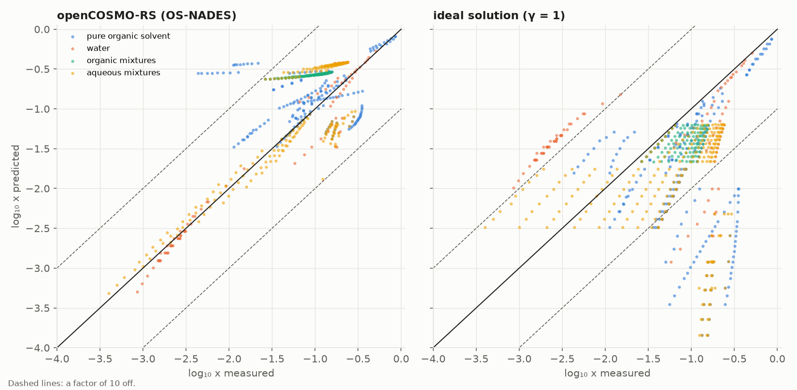
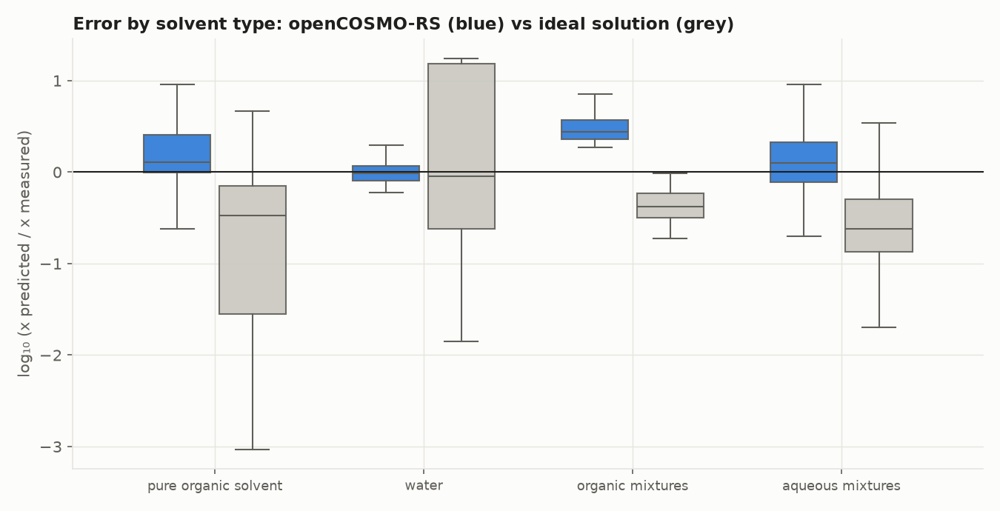
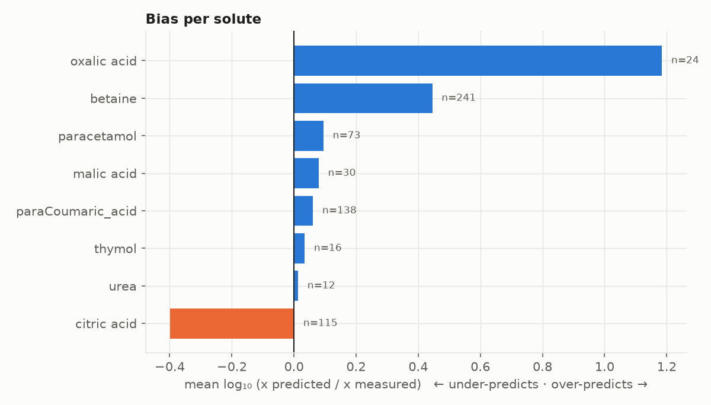

# OS-NADES accuracy benchmark

Predicted solid solubilities (openCOSMO-RS 24a, library σ-surfaces and fusion data, iterative SLE) compared with **every** experimental solubility data set in the NIST/TRC ThermoML Archive for the library's solid compounds whose solvent components are all in the library. Nothing was hand-picked or tuned.

## Headline

* **649 data points** from **22 papers**, 65 solute–solvent systems, 8 solutes, 273–360 K.
* Typical error (mean |log₁₀ x_pred/x_exp|): **0.33**, i.e. a factor of **2.2**; RMSE 0.45 log units; mean bias +0.17.
* **49%** of points are within a factor of 2, **98%** within a factor of 10.
* The ideal-solution model (γ = 1, same fusion data) has AAD 0.80; openCOSMO-RS is closer than ideal for **76%** of points.
* Removing each solute's constant offset (an error in its fusion data shifts all its solvents equally) leaves AAD **0.15** (factor 1.4): this is the error of the activity-coefficient model itself, i.e. how well it ranks and scales solvents for one solute.
* Ranking of pure solvents for a given solute (what screening needs): median Spearman ρ = **0.80** over 14 solute/temperature groups with ≥ 4 solvents.

## What is and is not covered

* **No deep eutectic solvent was benchmarked.** ThermoML holds no solubility data of the library's compounds in choline chloride (or other) NADES: the one DES paper it lists for paracetamol (doi:10.1016/j.fluid.2018.01.017) is archived with its water data only. NADES predictions remain unvalidated by this benchmark; the known COSMO-RS over-stabilisation of salts (see README) applies.
* No binary eutectic (two solid-formers) data matched: the measured partners of thymol, menthol and decanoic acid in ThermoML are not in the library.
* Coverage is limited by the library: data sets were skipped when a component was missing. The most frequent missing solvents were 2-propanol, 1-butanol, 1-propanol and acetonitrile; computing them with ORCA would add data from about 20 more papers.
* Data per solute are uneven: betaine (241 points) and citric acid (115) come mostly from one or two mixed-solvent studies, so they weigh heavily in the overall numbers.

## By solvent type

| group | points | papers | systems | bias (log₁₀) | AAD (log₁₀) | RMSE (log₁₀) | within ×2 | within ×10 | ideal AAD | better than ideal |
|---|---:|---:|---:|---:|---:|---:|---:|---:|---:|---:|
| pure organic solvent | 215 | 12 | 18 | +0.19 | 0.38 | 0.55 | 52% | 93% | 0.88 | 71% |
| water | 91 | 15 | 5 | -0.04 | 0.15 | 0.22 | 85% | 100% | 0.89 | 97% |
| organic mixtures | 110 | 1 | 11 | +0.48 | 0.48 | 0.50 | 5% | 100% | 0.37 | 46% |
| aqueous mixtures | 233 | 4 | 31 | +0.08 | 0.30 | 0.37 | 53% | 100% | 0.89 | 85% |

## By solute

| group | points | papers | systems | bias (log₁₀) | AAD (log₁₀) | RMSE (log₁₀) | within ×2 | within ×10 | ideal AAD | better than ideal |
|---|---:|---:|---:|---:|---:|---:|---:|---:|---:|---:|
| urea | 12 | 4 | 1 | +0.01 | 0.01 | 0.01 | 100% | 100% | 0.05 | 83% |
| thymol | 16 | 1 | 2 | +0.03 | 0.05 | 0.06 | 100% | 100% | 0.13 | 100% |
| paraCoumaric_acid | 138 | 3 | 14 | +0.06 | 0.12 | 0.18 | 86% | 100% | 0.64 | 88% |
| malic acid | 30 | 2 | 2 | +0.08 | 0.13 | 0.15 | 100% | 100% | 0.34 | 87% |
| paracetamol | 73 | 5 | 4 | +0.09 | 0.15 | 0.23 | 89% | 100% | 0.75 | 77% |
| citric acid | 115 | 5 | 15 | -0.40 | 0.43 | 0.47 | 21% | 100% | 2.12 | 100% |
| betaine | 241 | 2 | 24 | +0.45 | 0.45 | 0.48 | 22% | 100% | 0.45 | 60% |
| oxalic acid | 24 | 1 | 3 | +1.18 | 1.18 | 1.28 | 0% | 33% | 0.46 | 8% |

Log₁₀ errors: AAD 0.30 = factor 2, 1.0 = factor 10. *Bias* > 0: over-predicts solubility. *Better than ideal*: share of points where openCOSMO-RS is closer to experiment than γ = 1.

### Fusion data used (they set each solute's offset)

| solute | ΔH_fus (kJ/mol) | T_m (K) | bias | source |
|---|---:|---:|---:|---|
| urea | 13.90 | 405.8 | +0.01 | NIST (Kozyro, Dalidovich, et al., 1986, 2) (via Cheméo) |
| thymol | 22.01 | 324.0 | +0.03 | NIST (Chickos, Braton, et al., 1991) (via Cheméo) |
| paraCoumaric_acid | 34.30 | 494.3 | +0.06 | doi:10.1021/acs.jced.6b00361 – Measurement and Correlation of the Solubility of p-Coumaric Acid in Nine Pure a |
| malic acid | 33.52 | 402.0 | +0.08 | doi:10.1016/0040-6031(90)80082-a – Ceolin, Szwarc & Lepage, Thermochim. Acta 1990, 158, 347 (DL-malic acid, st |
| paracetamol | 27.10 | 443.6 | +0.09 | library value |
| citric acid | 59.20 | 424.9 | -0.40 | doi:10.1021/acs.jced.8b00064 – Santaella et al., J. Chem. Eng. Data 2018, 63, 3252 (DSC, anhydrous citric acid |
| betaine | 17.98 | 566.2 | +0.45 | doi:10.1021/je500267w – Wang, Zhang & Wang, J. Chem. Eng. Data 2014, 59, 2511: group-contribution estimate (be |
| oxalic acid | 26.24 | 464.4 | +1.18 | NIST (Wilhoit and Shiao, 1964, 2); ΔH_fus estimated from T_m (Walden's rule, ΔS_fus = 56.5 J/mol/K) (via Chemé |

## Largest systematic deviations (mean log₁₀ error per solute + solvent family)

| solute | solvent | points | T (K) | bias | source |
|---|---|---:|---|---:|---|
| oxalic acid | ethyl acetate | 8 | 288–323 | +1.61 | doi:10.1016/j.jct.2014.05.009 |
| oxalic acid | acetone | 8 | 288–323 | +1.40 | doi:10.1016/j.jct.2014.05.009 |
| betaine | ethanol | 10 | 283–328 | +0.76 | doi:10.1021/je2011659 |
| paracetamol | acetone | 8 | 293–323 | +0.63 | doi:10.1021/acs.jced.7b00118 |
| oxalic acid | ethanol | 8 | 288–323 | +0.55 | doi:10.1016/j.jct.2014.05.009 |
| citric acid | methanol + water | 13 | 278–303 | -0.51 | doi:10.1021/je400838e |
| citric acid | methanol | 6 | 278–303 | -0.50 | doi:10.1021/je400838e |
| citric acid | ethanol + water | 30 | 278–322 | -0.50 | doi:10.1016/j.fluid.2013.05.014 |
| citric acid | water | 12 | 303–333 | -0.50 | doi:10.1016/j.fluid.2011.09.033 |
| betaine | ethanol + methanol | 110 | 283–329 | +0.48 | doi:10.1021/je2011659 |
| citric acid | ethanol | 35 | 278–333 | -0.44 | doi:10.1016/j.fluid.2011.09.033 |
| paraCoumaric_acid | ethyl acetate | 13 | 293–333 | +0.44 | doi:10.1016/j.jct.2013.02.013 |

## Best-predicted systems (≥ 3 points)

| solute | solvent | points | T (K) | bias | source |
|---|---|---:|---|---:|---|
| paraCoumaric_acid | ethanol | 17 | 293–333 | +0.00 | doi:10.1021/acs.jced.6b00361 |
| citric acid | acetone | 19 | 288–333 | -0.00 | doi:10.1021/je101167z |
| paraCoumaric_acid | ethanol + water | 90 | 293–333 | -0.00 | doi:10.1021/acs.jced.6b00361 |
| paraCoumaric_acid | methanol | 9 | 293–333 | +0.01 | doi:10.1021/acs.jced.6b00361 |
| urea | water | 12 | 283–348 | +0.01 | doi:10.1016/j.fluid.2015.11.016 |
| thymol | methanol | 8 | 279–313 | +0.02 | doi:10.1016/j.jct.2015.09.010 |
| malic acid | water | 15 | 298–333 | +0.03 | doi:10.1016/j.fluid.2011.09.033 |
| paracetamol | water | 41 | 273–353 | -0.03 | doi:10.1016/j.fluid.2016.05.012 |

## Solvent ranking (pure solvents)

| solute | T (K) | solvents | Spearman ρ |
|---|---:|---:|---:|
| citric acid | 305 | 4 | 0.40 |
| paraCoumaric_acid | 295 | 4 | 0.80 |
| paraCoumaric_acid | 300 | 4 | 0.80 |
| paraCoumaric_acid | 305 | 4 | 0.80 |
| paraCoumaric_acid | 310 | 4 | 0.80 |
| paraCoumaric_acid | 315 | 4 | 0.80 |
| paraCoumaric_acid | 320 | 4 | 0.80 |
| paraCoumaric_acid | 325 | 4 | 0.80 |
| paraCoumaric_acid | 330 | 4 | 0.80 |
| paraCoumaric_acid | 335 | 4 | 0.80 |
| paracetamol | 295 | 4 | 0.20 |
| paracetamol | 305 | 4 | 0.20 |
| paracetamol | 315 | 4 | 0.20 |
| paracetamol | 325 | 4 | 0.40 |

## Data and method

* Source: NIST/TRC ThermoML Archive, searched by InChIKey for 8 library solids (T_m ≥ 285 K); 595 records read. Points were kept when the measured property is the liquid-phase amount of a component coexisting with its own crystal, all other components are in the library, and the solvent composition is fully specified. Mass fractions and molalities were converted to mole fractions; mixed-solvent compositions on a solute-free basis.
* Skipped data sets (counts of points/sets): component not in the library: 897, several solid phases in the data set: 13.
* 0 points could not be predicted (solver did not converge) and are excluded from the statistics.
* Choline chloride is a formula unit in the data and two COSMO species (choline⁺, Cl⁻) in the model; predictions are converted to formula units before comparison.
* Fusion data are the library values the app uses (see the Compound library page); errors in ΔH_fus and T_m shift all solvents of a solute equally, which shows up as a per-solute bias.
* Reproduce: `.venv/bin/python -m benchmarks.accuracy all` (downloads are cached in `benchmarks/cache/`).

## References

| DOI | year | points | solutes | title |
|---|---|---:|---|---|
| [10.1021/je2011659](https://doi.org/10.1021/je2011659) | 2012 | 240 | betaine | Solubility and Solution Thermodynamics of Betaine in Different Pure Solvents and Binary Mixtures |
| [10.1021/acs.jced.6b00361](https://doi.org/10.1021/acs.jced.6b00361) | 2016 | 126 | paraCoumaric_acid | Measurement and Correlation of the Solubility of p-Coumaric Acid in Nine Pure and Water + Ethanol Mixed Solvents at Temperatures from 293.15 to 333.15 K |
| [10.1021/acs.jced.7b00118](https://doi.org/10.1021/acs.jced.7b00118) | 2017 | 39 | paracetamol | Pressurized-Synthetic Methodology for Solubility Determination at Elevated Temperatures with Application to Paracetamol in Pure Solvents |
| [10.1021/je400838e](https://doi.org/10.1021/je400838e) | 2014 | 38 | citric acid | Solubility of 2-Hydroxypropane-1,2,3-tricarboxylic Acid Monohydrate in Different Binary Solvents from (278.15 to 303.15) K |
| [10.1021/je101167z](https://doi.org/10.1021/je101167z) | 2011 | 38 | citric acid | Solubilities of 3-Carboxy-3-hydroxypentanedioic Acid in Ethanol, Butan-1-ol, Water, Acetone, and Methylbenzene |
| [10.1016/j.fluid.2011.09.033](https://doi.org/10.1016/j.fluid.2011.09.033) | 2012 | 28 | citric acid, malic acid | Solubility of citric, malonic, and malic acids in different solvents from 303.2 to  333.2 K |
| [10.1016/j.jct.2014.05.009](https://doi.org/10.1016/j.jct.2014.05.009) | 2014 | 24 | oxalic acid | An odd-even effect on solubility of dicarboxylic acids in organic solvents |
| [10.1016/j.fluid.2013.05.014](https://doi.org/10.1016/j.fluid.2013.05.014) | 2013 | 23 | citric acid | Solubility of citric acid in water, ethanol, n-propanol and in mixtures of ethanol + water |
| [10.1016/j.fluid.2014.06.017](https://doi.org/10.1016/j.fluid.2014.06.017) | 2014 | 16 | malic acid | Solubility of DL-malic acid in water, ethanol and in mixtures of ethanol + water |
| [10.1016/j.jct.2015.09.010](https://doi.org/10.1016/j.jct.2015.09.010) | 2016 | 16 | thymol | Solubility and solution thermodynamics of thymol in six pure organic solvents |
| [10.1016/j.fluid.2016.05.012](https://doi.org/10.1016/j.fluid.2016.05.012) | 2016 | 12 | paracetamol | Aqueous solubility of acetaminophen in the presence of 1-hexyl-3- methyl imidazolium bromide, ionic liquid as co-solvent |
| [10.1021/acs.jced.7b00206](https://doi.org/10.1021/acs.jced.7b00206) | 2017 | 9 | paracetamol | Solid Liquid Phase Equilibrium of N,N'-Piperazinebis(neopentylglycol)phosphoramidate in Selected Solvents from T = (293.15 to 333.15) K |
| [10.1021/acs.jced.6b01044](https://doi.org/10.1021/acs.jced.6b01044) | 2017 | 8 | paraCoumaric_acid | Determination and Thermodynamic Modeling of Solid Liquid Phase Equilibrium for Esomeprazole Sodium in Monosolvents and in the (Ethanol + Ethyl Acetate) Binary Solvent Mixtures |
| [10.1021/je4008525](https://doi.org/10.1021/je4008525) | 2013 | 7 | paracetamol | Solubilization Behavior of Paracetamol in Transcutol Water Mixtures at (298.15 to 333.15) K |
| [10.1021/je501111d](https://doi.org/10.1021/je501111d) | 2015 | 7 | urea | Measurement and Correlation of the Solubility for 4,4'-Diaminodiphenylmethane in Different Solvents |
| [10.1016/j.fluid.2018.01.017](https://doi.org/10.1016/j.fluid.2018.01.017) | 2018 | 6 | paracetamol | Experimental determination and correlation of acetaminophen solubility in aqueous solutions of choline chloride based deep eutectic solvents at various temperatures |
| [10.1016/j.jct.2013.02.013](https://doi.org/10.1016/j.jct.2013.02.013) | 2013 | 4 | paraCoumaric_acid | Solubilities of p-coumaric and caffeic acid in ionic liquids and organic solvents |
| [10.1021/acs.jced.5b00293](https://doi.org/10.1021/acs.jced.5b00293) | 2015 | 3 | urea | (Solid + Liquid) Phase Equilibrium in the Aqueous Ternary System NaH2PO4 + CO(NH2)2 + H2O at (308.15, 328.15, and 348.15) K |
| [10.1021/acs.jced.8b00064](https://doi.org/10.1021/acs.jced.8b00064) | 2018 | 2 | citric acid | Phase Equilibrium Behavior in Mixtures Containing Tributyl Citrate, Citric Acid, Butan-1-ol, and Water |
| [10.1016/j.fluid.2018.07.016](https://doi.org/10.1016/j.fluid.2018.07.016) | 2018 | 1 | urea | Solid-liquid phase equilibria in aqueous solutions of four common fertilizers at 303.2 K and atmospheric pressure |
| [10.1016/j.fluid.2015.11.016](https://doi.org/10.1016/j.fluid.2015.11.016) | 2016 | 1 | urea | Phase diagrams of Na2SO4-MgSO4-CO(NH2)2-H2O system at 60 C and their application |
| [10.1016/j.fluid.2015.07.004](https://doi.org/10.1016/j.fluid.2015.07.004) | 2016 | 1 | betaine | Compatible solutes: Thermodynamic properties relevant for effective protection against osmotic stress |
